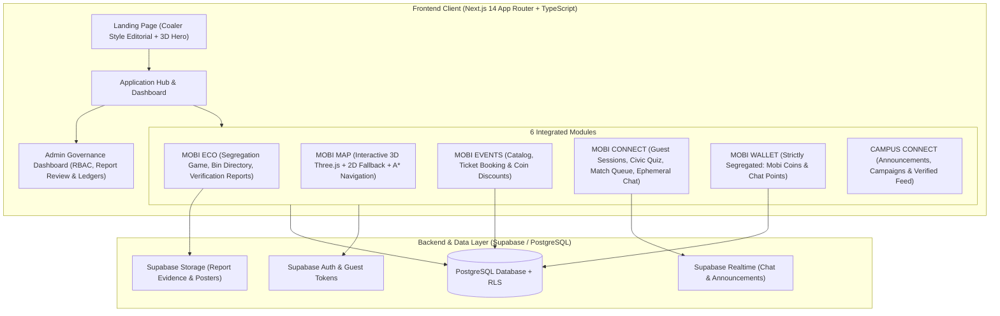

# MOBI — Evergreen Future Campus
## Master Product Architecture, Design System & Phased Implementation Plan

> [!NOTE]
> **Product Identity**: MOBI — Evergreen Future Campus  
> **Tagline**: *One Campus. One Community. A Better Tomorrow.*  
> **Brand Message**: *Made by Students. For Students.*  
> **Target Campus**: MEA Engineering College, Perinthalmanna (Kerala, India)

---

## 1. Asset Inventory & Visual Reference Analysis

We have analyzed all three provided primary reference images and incorporated their design specifications into our architecture.

### Reference Comparison Carousel

````carousel

<!-- slide -->

<!-- slide -->

````

### Detailed Inspection Findings

| Reference File | Type | Key Features & Technical Extraction | Utilization in MOBI |
|---|---|---|---|
| **Reference A** (`reference-a-coaler.jpg`) | Visual & Layout Reference | • Deep forest green `#06251D` background with dark emerald `#0B3829`<br>• Alternating dark forest and crisp light `#F7F8F6` editorial sections<br>• Hero headline: *"YOUR CAMPUS. YOUR COMMUNITY. YOUR FUTURE."*<br>• Central 3D hero showcase with interactive environmental lighting<br>• Structured cards: *"How It Works"*, *"Why It Matters"*, *"Features We Provide"*, *"Solutions for Everyone"*, *"Student Success Stories"*, *"Final CTA"* | Serves as the core visual grammar for the marketing landing page and design tokens. |
| **Reference C** (`reference-c-mea-original-map.jpg`) | Authoritative Geographical Ground Truth | • Highway SH39 & Perumbilavu-Nilambur Road<br>• Key buildings: Main Block (MEA Engineering College Perinthalmanna), MEA Auditorium, Civil Department, MEA Men's Hostel, Mechanical Workshop, MEA College Bus Stop<br>• Adjacent schools: Noorul Islam HSS, AL Fouze Jamia English Medium School, Usmankka's Pub<br>• White internal campus pathway network & campus perimeter boundary | Establishes the authoritative normalized local coordinate system `(x, y)` and node connectivity. |
| **Reference D** (`reference-d-annotated-campus-concept.jpg`) | Annotated 3D Concept & Amenity Placement | • 4 Waste Bin categories: Blue (General), Yellow (Dry), Green (Wet), Red (Special/E-waste)<br>• Blue washroom markers & cyan water droplet stations<br>• Purple seating benches & yellow streetlights<br>• Orange campus entrance arch<br>• Blue dotted directional navigation paths | Supplies the inventory of campus objects with explicit PROPOSED status markers for unverified coordinates. |

---

## 2. Design System & Tokens

Following the nature-inspired palette specified in Section 3.2:

```css
:root {
  /* Brand Greens */
  --mobi-forest: #06251D;      /* Primary dark surface */
  --mobi-green-dark: #0B3829;  /* Secondary dark card background */
  --mobi-emerald: #20C878;     /* Primary action CTA */
  --mobi-green-fresh: #55D98A; /* Highlights & success */
  --mobi-mint-pale: #E5F6EA;   /* Light green accents & badges */
  
  /* Neutrals & Surfaces */
  --mobi-bg-light: #F7F8F6;    /* Light section background */
  --mobi-card-light: #FFFFFF;  /* Light card background */
  --mobi-text-primary: #14231D;
  --mobi-text-secondary: #65736B;
  --mobi-border: #E2E8E4;
  
  /* Module Accent Indicators */
  --mobi-eco: #20C878;
  --mobi-map: #3B82F6;
  --mobi-events: #8B5CF6;
  --mobi-connect: #EC4899;
  --mobi-wallet: #F59E0B;
  --mobi-campus: #10B981;
}
```

Typography: **Manrope** / **Sora** modern sans-serif with geometric hierarchy.
Android Touch Target rule: Minimum **48px × 48px** for all interactive targets.

---

## 3. System Architecture Diagram



---

## 4. Database Schema & Security Models (PostgreSQL + RLS)

### Separation of Currencies (Part 10 & 13)
- `wallets`:
  - `mobi_coins`: Earned ONLY via verified `approved` waste reports. Spent ONLY on event discounts (1 Coin = ₹1 discount).
  - `chat_points`: Earned ONLY via completing civic quiz rounds (5/5 correct = 3 points). Spent ONLY on starting random chat sessions (1 session = 1 point).
  - **Zero exchangeability rule**: Under no circumstances can coins convert to points or vice versa, nor withdraw to cash.

### Key Database Tables
1. `profiles` & `guest_sessions`: Student profile with verified student status or temporary guest identifier.
2. `buildings` & `facilities`: Campus footprints, coordinates, verification status (`confirmed` vs `proposed`), nearest graph nodes.
3. `campus_nodes` & `campus_edges`: Graph topology for Dijkstra / A* path computation.
4. `waste_reports` & `report_reviews`: Student submissions (with bin ID, photo, GPS/manual location, timestamp) and admin review audit log.
5. `eco_quiz_questions` & `civic_quiz_questions`: Bank of questions with server-side validation.
6. `events` & `event_registrations`: Event ticketing with server-verified coin deductions and atomic locking.
7. `chat_queue`, `chat_sessions` & `temporary_messages`: Ephemeral matching and rate-limited messaging.
8. `announcements`: Verified college notices with category filters.
9. `admin_audit_logs`: Complete immutable record of admin actions.

---

## 5. Phased Execution Roadmap

- [x] **Phase 0: Inspection & Planning** (Completed - References analyzed, coordinates traced, architecture defined)
- [ ] **Phase 1: Project Setup & Coaler-Style Landing Page** (Next.js 14, Tailwind, Three.js 3D Hero, Responsive Design)
- [ ] **Phase 2: Application Dashboard & Bottom Navigation Shell** (Android-first responsive layout, state management, PWA foundation)
- [ ] **Phase 3: MOBI ECO Module** (Waste game, directory, verified reporting workflow, audit review)
- [ ] **Phase 4: MOBI MAP 3D & 2D System** (Three.js MEA campus scene, interactive pins, Dijkstra route solver, 2D fallback)
- [ ] **Phase 5: MOBI EVENTS & MOBI WALLET** (Ticketing, 1 Coin = ₹1 discount calculation, immutable ledger)
- [ ] **Phase 6: MOBI CONNECT** (Civic quiz gatekeeper, matching queue, ephemeral messaging, report/block)
- [ ] **Phase 7: CAMPUS CONNECT & Admin Governance** (Official announcements, moderation center, report review)
- [ ] **Phase 8: End-to-End Verification, Performance & Optimization** (Automated tests, responsive validation, documentation)
